<div align="center">

# 🏭 Conveyor Control – SysML Model-Based Design

**Modelling and control of a three-conveyor transfer system with SysML in IBM Rhapsody: one model that drives both a simulator and the real bench, with a priority protocol for the shared conveyor**


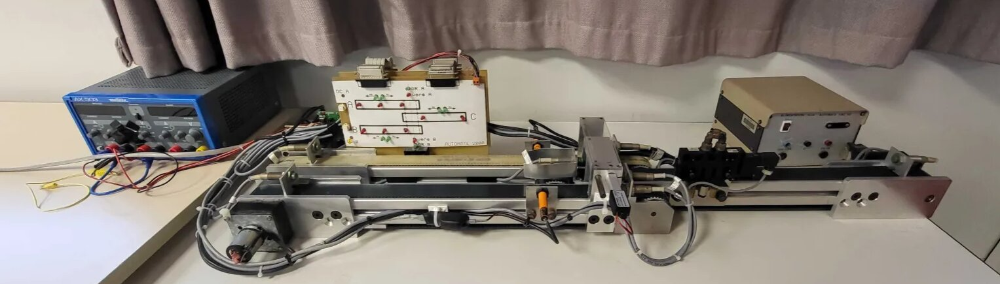

</div>

> [!NOTE]
> 🇫🇷 **This project was carried out in French.** Block, state, event and operation names (`Tapis` = conveyor, `Griffe` = switching claw, `avancer` = move forward, `reculer` = move back…) are in French. This README is in English so the project can be read by a wider audience.

---

## 📖 About

Mini-project for the **SysML pour les systèmes embarqués** (*SysML for embedded systems*) course (academic project), 4th year, embedded systems track (December 2025 – January 2026), carried out as a **team of two students**.

The goal: model a real-time transfer system with **SysML**, design its control software in **IBM Rhapsody**, generate the **C++ code**, and validate it first on a simulator, then on the **real bench**.

### The system
- **Three conveyors**, each with its own motor: two upstream (**A** and **B**) and one downstream (**C**).
- A **switching claw** driven by a pneumatic cylinder, which connects A or B to C.
- **Two bins** carrying the product, one on A and one on B.
- **12 sensors**: start / middle / end of A and B (`deba`, `mia`, `fina`, `debb`, `mib`, `finb`), start / end of C (`debc`, `finc`), claw position (`versa`, `versb`), and two start buttons (`dca`, `dcb`).
- **7 commands**: forward / backward for each conveyor (`mava`, `mara`, `mavb`, `marb`, `mavc`, `marc`) and the claw position (`ev`).

**A cycle** takes a bin from its conveyor to the end of conveyor C and back: forward to the middle sensor, wait for the claw, cross onto C, go to the end of C, come back, and return to the start position.

## 🧩 Model-based design

The model follows the SysML process from requirements to code.

<table>
<tr>
<td align="center">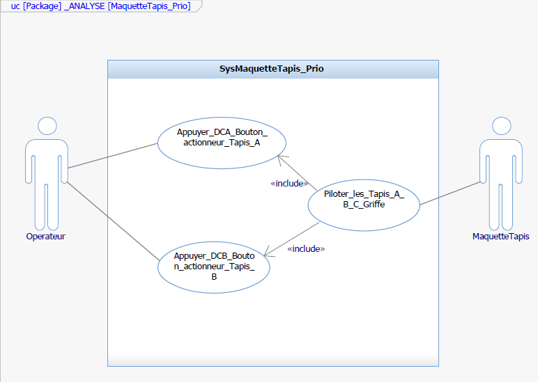<br><sub><b>Use cases</b>: the operator starts cycle A or B with DCA / DCB</sub></td>
<td align="center">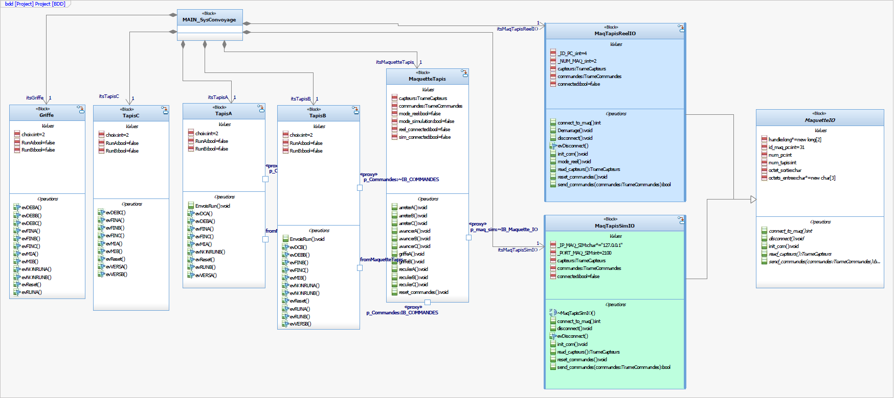<br><sub><b>BDD</b>: one block per conveyor, the claw, the bench and its two I/O targets</sub></td>
</tr>
</table>

<div align="center">
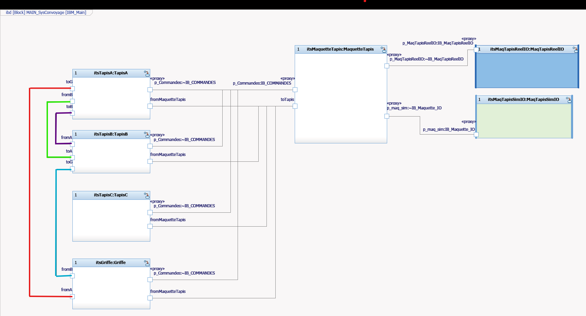<br>
<sub><b>IBD</b>: commands go through a proxy port, sensor states arrive through event ports</sub>
</div>

### Architecture

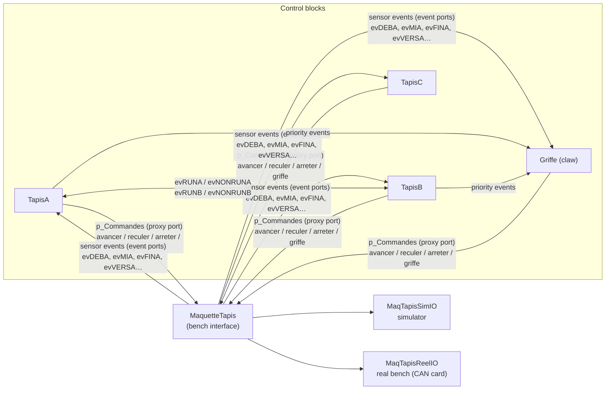

- **Commands**: `MaquetteTapis` exposes its operations (`avancerA()`, `reculerC()`, `griffeA()`…) on a **proxy port** (`p_Commandes`); each control block uses the conjugated port to call them. The operations only write the command frame (e.g. `avancerA()` → `mava = 1, mara = 0`).
- **Sensors**: every 100 ms, `MaquetteTapis` sends the command frame, reads the sensor frame and **multicasts one event per active sensor** (`evDEBA`, `evMIA`, `evFINC`…). These events are the triggers of all the other statecharts.
- **One model, two targets**: the same control logic drives either the **simulator** or the **real bench**. Only the I/O block changes, and the operator picks the mode on the panel.

<div align="center">
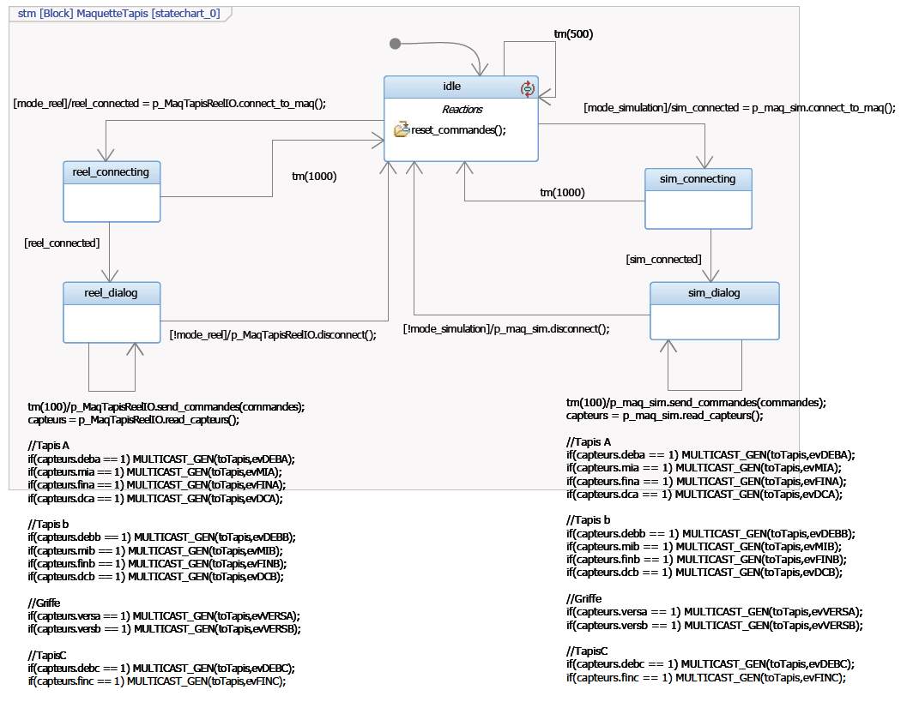<br>
<sub><b>MaquetteTapis</b>: connect to the simulator or to the real bench, then exchange commands and sensors every 100 ms</sub>
</div>

## 🔀 The key problem: a shared conveyor

Bins A and B both need **conveyor C and the claw**, so the two cycles must never overlap. We solved it with a **priority protocol** based on events:

- each upstream conveyor owns a flag (`RunA`, `RunB`) and broadcasts it to the other conveyor and to the claw (`evRUNA` / `evNONRUNA`, `evRUNB` / `evNONRUNB`), resent periodically by `envoisRun()`;
- **A has priority**: `RunA` is set as soon as DCA is pressed, while B waits at its middle sensor;
- when cycle A is over (bin back at `deba`), A releases the priority and **B runs its cycle**; at the end B gives the priority back.

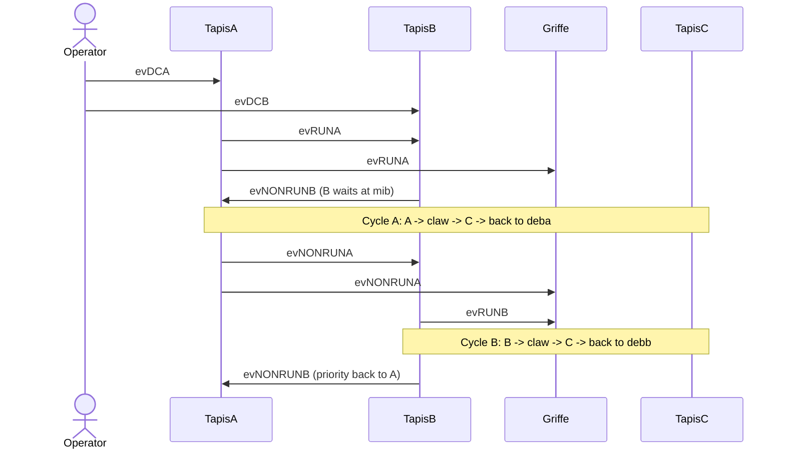

### Statechart of conveyor A (final version)

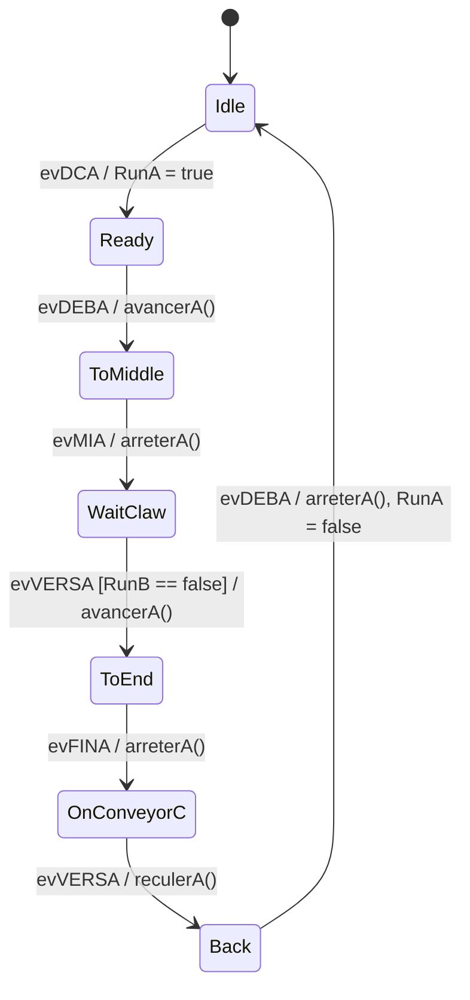

Conveyor B has the same structure without setting its flag at start, so it stops at `mib` until `RunA` is released. The claw and conveyor C follow the cycle of whichever bin is active.

<table>
<tr>
<td align="center">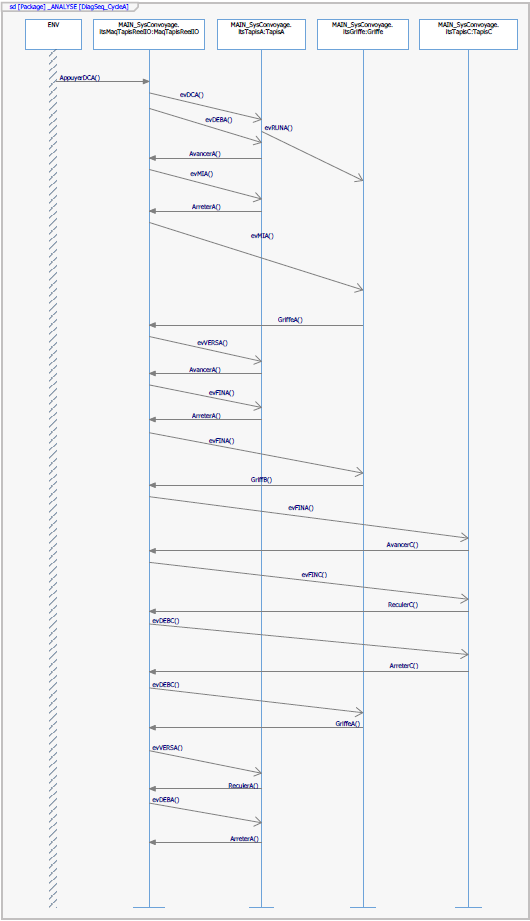<br><sub><b>Sequence diagram</b> of cycle A</sub></td>
<td align="center">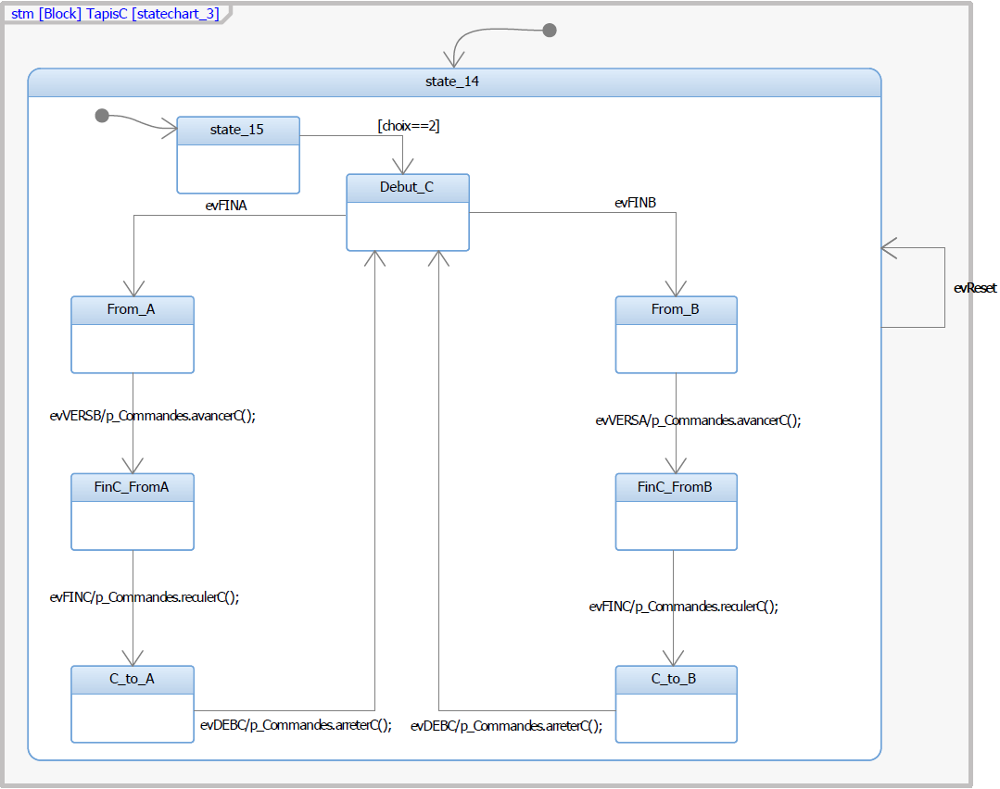<br><sub><b>Conveyor C</b>: two symmetric paths depending on which bin arrives</sub></td>
</tr>
</table>

## 🖥️ Control panel

<div align="center">
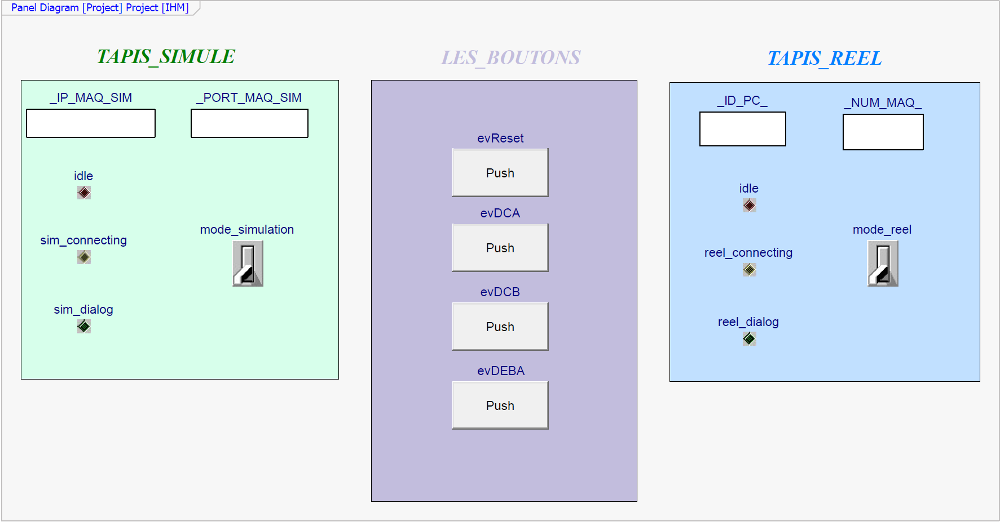
</div>

The panel connects to the **simulator** (IP / port) or to the **real bench** (PC / bench number), shows the connection state, and provides the operator buttons (`evDCA`, `evDCB`, reset…).

## 🧠 Lessons learned

- **Simulation is not reality.** Our first design shared the conveyors' states through proxy ports and assumed the middle sensors would stay active while a bin was present. It worked in the simulator but **blocked the cycles on the real bench**, where the sensors are not continuously active. Moving to **events** (state changes) instead of reading levels fixed it. The first statecharts are kept in the model as an archive.
- **Shared resources need an explicit protocol**: a simple token-like priority with release at the end of each cycle is easier to validate than letting each block infer the others' states.
- **Model-based development** pays off: the same validated model generates the code for both targets, and sequence diagrams make the interactions reviewable before running anything.
- **Next steps:** continuous operation (cycles chained automatically) and a fairer scheduling policy than a fixed priority for A.

## 🚀 Open the project

Requirements: **IBM Rhapsody** (C++, SysML profile) and **Microsoft Visual C++** on Windows.

1. Open `rhapsody/Project.rpyx` in Rhapsody.
2. Generate and build the `CodesGeneres` component (configuration `AnimationConfig`).
3. Run with animation, open the **IHM** panel and connect to the simulator or to the bench.

The generated C++ is in [`rhapsody/CodesGeneres/AnimationConfig`](rhapsody/CodesGeneres/AnimationConfig) (`TapisA.cpp`, `Griffe.cpp`, `MaquetteTapis.cpp`…).

> [!IMPORTANT]
> The real-bench target uses the driver of the **ADLINK PCI-7841** CAN card (`Pci7841.h`, `7841_x64.lib`). These vendor files come with the lab setup and are not included, nor is the course simulator.

## 📁 Repository structure

```
rhapsody/
├── Project.rpyx                       # Rhapsody project
├── Project_rpy/                       # model units: _ANALYSE (use cases), _DESIGN (blocks,
│                                      #   statecharts, IBD, sequences), base packages
├── CodesGeneres/AnimationConfig/      # generated C++ code and makefile
└── Typedef.h, resource.h
docs/                                  # images used in this README
```

The Git history follows the project from the base model (December 2025) to the sequence diagrams (end of January 2026).

## 👤 Author

**Sivaharan Kumara Segaram**, embedded systems engineering student. Project carried out with a teammate.
